# Cloud-Native CRM — Microservices, Kubernetes & Observability

**A distributed Customer Relationship Management (CRM) platform built with FastAPI and React, containerized with Docker, orchestrated by Kubernetes, and enhanced with Dapr, Redis, Zipkin, Prometheus, and Grafana.**

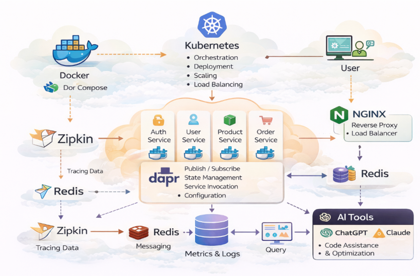
*Figure: Cloud-native CRM architecture from the project report.*

## Overview

This academic project demonstrates the design, deployment, and observability of a cloud-native CRM application. Independent services handle authentication, customers, products, orders, and notifications, while a React frontend provides the user interface. The deployment combines Docker Compose for multi-container execution and a local Docker Desktop Kubernetes cluster for orchestration and resilience testing.

**Project highlights:**
- Independent **FastAPI** backend microservices and **React** frontend
- **Docker / Docker Compose** for containerization and local multi-service execution
- **Kubernetes** Deployments, Services, replication, self-healing, and HPA configuration
- **Dapr** service invocation, Redis-backed publish/subscribe and state management
- **Zipkin** distributed tracing, **Prometheus** metrics and **Grafana** dashboards
- **NGINX** reverse proxy for frontend/backend request routing

## Technology stack

| Layer | Technologies |
| --- | --- |
| Frontend | React, JavaScript |
| Backend | Python, FastAPI, REST APIs |
| Containerization | Docker, Docker Compose |
| Orchestration | Kubernetes (Docker Desktop local cluster) |
| Service communication | Dapr sidecars, service invocation, pub/sub |
| State and messaging | Redis with Dapr components |
| Routing | NGINX reverse proxy |
| Distributed tracing | Zipkin |
| Metrics | Prometheus |
| Dashboards | Grafana |

## Application services

| Service | Responsibility |
| --- | --- |
| **Authentication** | User registration, sign-in, identity and access management |
| **Customer** | Create, view, update, delete and search customer records |
| **Product** | Product catalog, stock, prices, categories and sales-related analysis |
| **Order** | Order processing, pricing, tracking and status changes |
| **Notification** | Receive customer events over Dapr pub/sub; store recent notifications in a Redis-backed Dapr state store |
| **CRM frontend** | React-based interface communicating with backend APIs |

### Application screenshots

| Customer management | Order management |
| --- | --- |
| 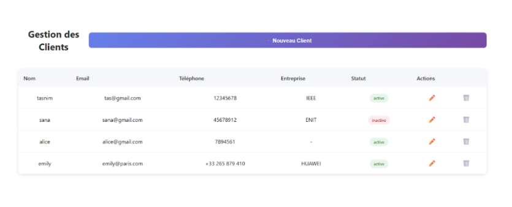 | 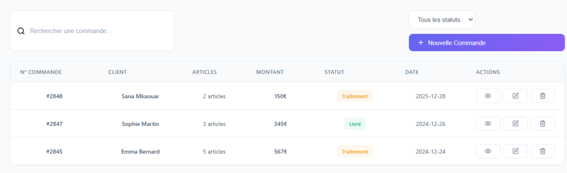 |

| Product management | User registration |
| --- | --- |
| 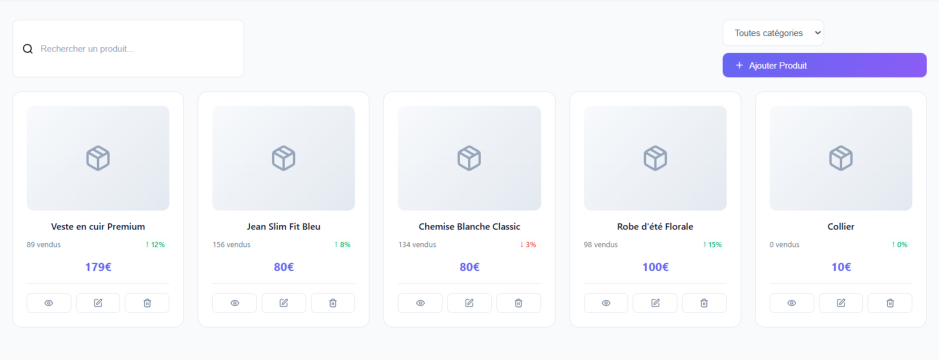 | 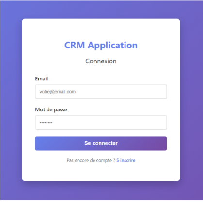 |

## Architecture and event flow

1. The **React frontend** sends HTTP requests to the application through the **NGINX reverse proxy**.
2. **FastAPI microservices** implement separate CRM business domains and expose REST endpoints.
3. **Kubernetes** manages container deployments, service discovery, replica counts and recovery from pod failures.
4. **Dapr sidecars** provide service invocation, asynchronous messaging and state access.
5. The **customer service** publishes customer-creation events using **Dapr pub/sub backed by Redis**; the **notification service** subscribes to those events.
6. The observability stack combines **Zipkin** for tracing, **Prometheus** for metrics and **Grafana** for visualization.

### Event-driven notifications

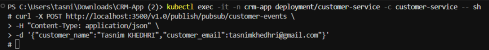
*Customer event publishing using Dapr, shown in the project report.*

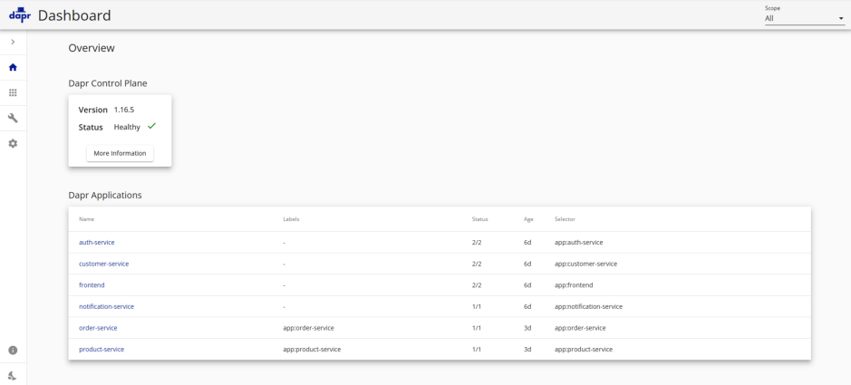
*Dapr dashboard showing enabled applications and components.*

## Deployment

### 1. Run with Docker Compose

The report documents container builds and startup using Docker Compose. From the root of the **application source repository**, with Docker Desktop running and the repository's Compose file available:

```bash
docker compose build
docker compose up -d
docker compose ps
```

To stop containers:

```bash
docker compose down
```

> **Note:** This README and its screenshots are extracted from the academic report. The report does not establish a universal public checkout URL, required environment variable values, or a fixed frontend port. Use the actual application's Compose configuration for environment settings and port mappings.

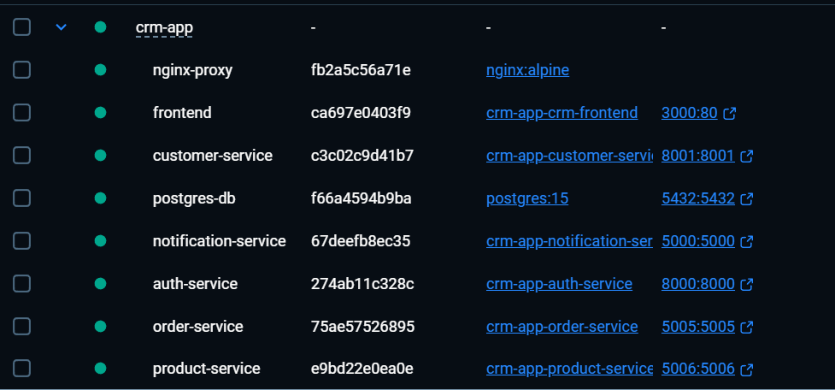
*Container runtime verification in Docker Desktop.*

### 2. Deploy to Kubernetes

The project used the **local Kubernetes cluster provided by Docker Desktop** and Kubernetes manifests organized in a `k8s` directory. With an appropriately configured cluster and the application images available:

```bash
kubectl get nodes
kubectl apply -f k8s/ -R
kubectl get pods -n crm-app
kubectl get services -n crm-app
```

> These are illustrative deployment commands consistent with the report's structure; confirm namespace definitions, image names, dependencies and manifest ordering in the source repository before running them.

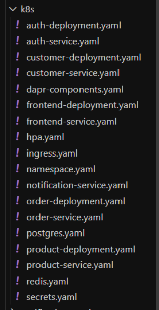

### 3. Resilience: replication, self-healing and autoscaling

The Kubernetes implementation demonstrates:

- **Replication:** multiple pod replicas for selected important services.
- **Self-healing:** deletion of a customer-service pod followed by Kubernetes replacement.
- **Horizontal Pod Autoscaler (HPA):** configuration to scale workloads according to resource usage.

| Replication | Self-healing test |
| --- | --- |
| 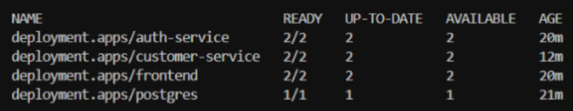 | 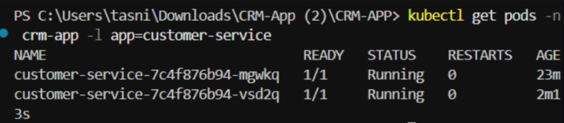 |

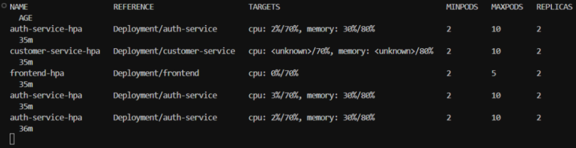
*HPA configuration shown in the report; no specific production scaling benchmark is claimed.*

## Observability

### Distributed tracing — Zipkin

Dapr forwards tracing information to Zipkin, enabling investigation of request timelines, spans, latency and relationships between services.

| Trace search | Trace details |
| --- | --- |
| 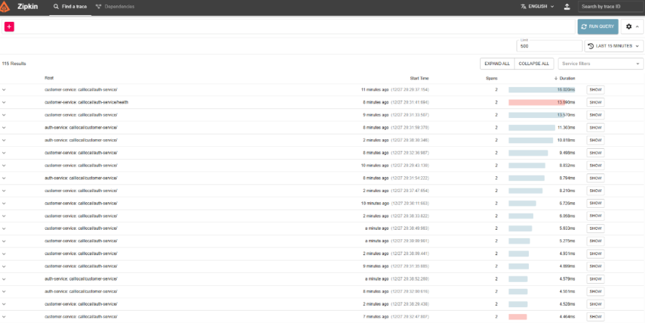 | 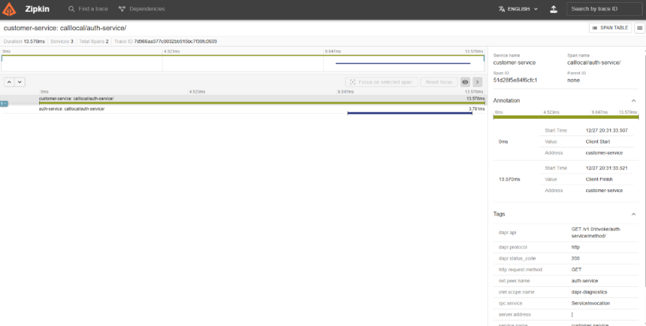 |

### Metrics collection — Prometheus

Prometheus collects metrics from CRM services, Dapr sidecars and Kubernetes components. Target status was inspected to validate scraping.

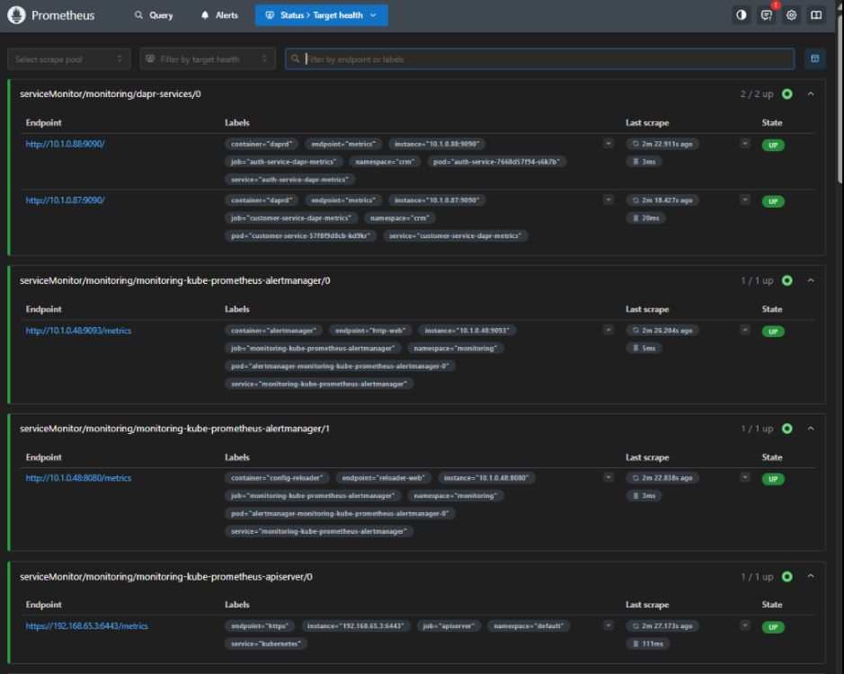

### Visualization — Grafana

Grafana presents both infrastructure-level and service-level dashboards, including CPU/memory consumption, HTTP request metrics and Kubernetes resource summaries.

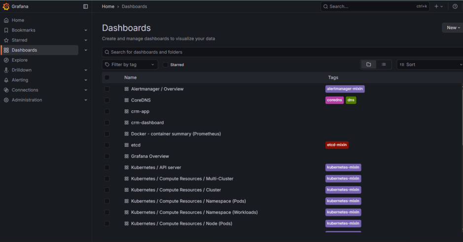

| Service resource usage | Application-level request metrics |
| --- | --- |
| 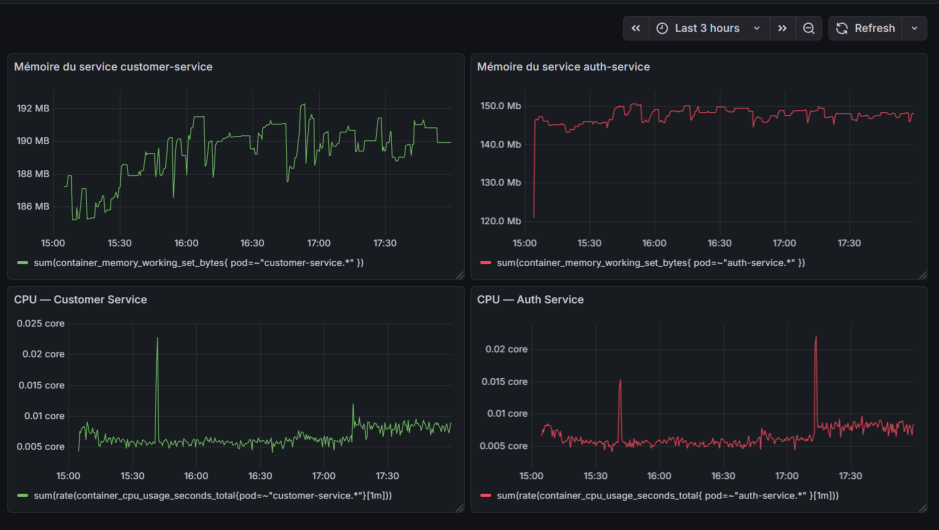 | 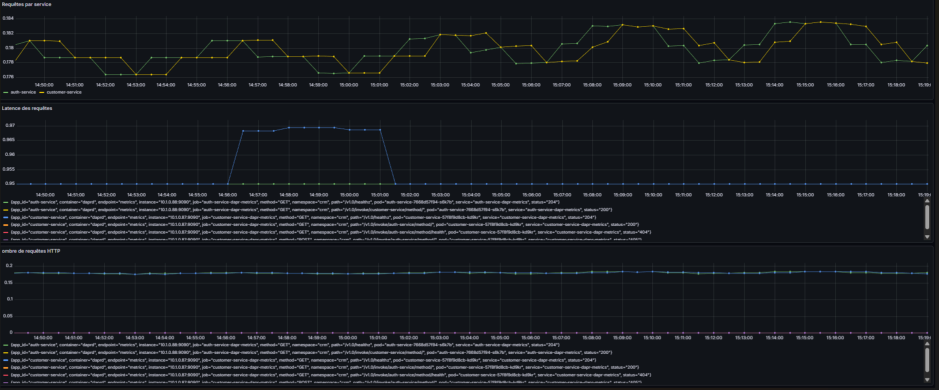 |

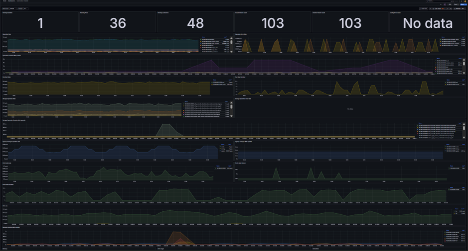

## Validation covered in the report

| Area | Demonstration |
| --- | --- |
| Containerization | Compose image builds and running containers |
| Kubernetes | Ready cluster node, running pods and internal services |
| Availability | Replicated services and recovery after a deliberately deleted pod |
| Autoscaling | HPA definitions for resource-aware scaling |
| Dapr | Pub/sub customer event and subscriber processing; state-store configuration |
| Tracing | Zipkin search results and detailed distributed traces |
| Metrics | Prometheus scrape target checks |
| Monitoring | Grafana dashboards for system resources and application requests |

## Project  
National Engineering School of Tunis (ENIT), University of Tunis El Manar  
Academic year **2025–2026**  
Course: *Advanced Services Architecture*  
Supervisor: **Mr. Mohamed Eschiekh** 

## Documentation and notes

- Screenshots in `docs/images/` are extracted from the submitted project report.
- This is an **academic development and demonstration environment**. It should not be interpreted as a production-hardened deployment.
- Before publishing source code, remove secrets, credentials, private configuration, credentials embedded in screenshots and unnecessary large binary files.
- Architecture and deployment descriptions reflect the report. To reproduce the application, the source repository must also contain the actual microservice code, Dockerfiles, Docker Compose configuration and Kubernetes manifests.

---

*Cloud-native microservices • Container orchestration • Event-driven communication • Distributed observability*
